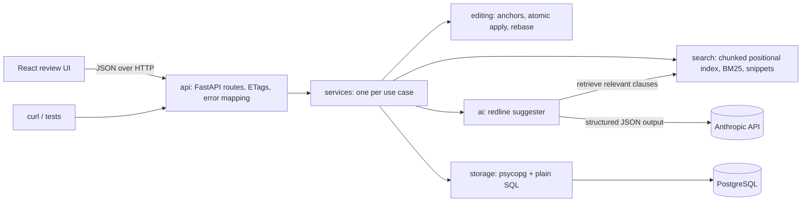
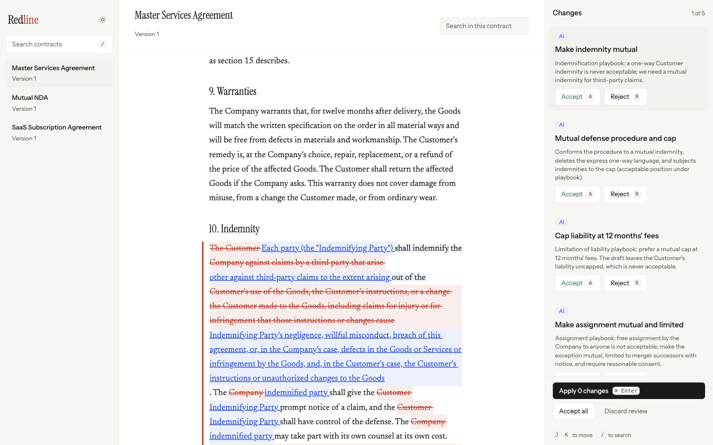
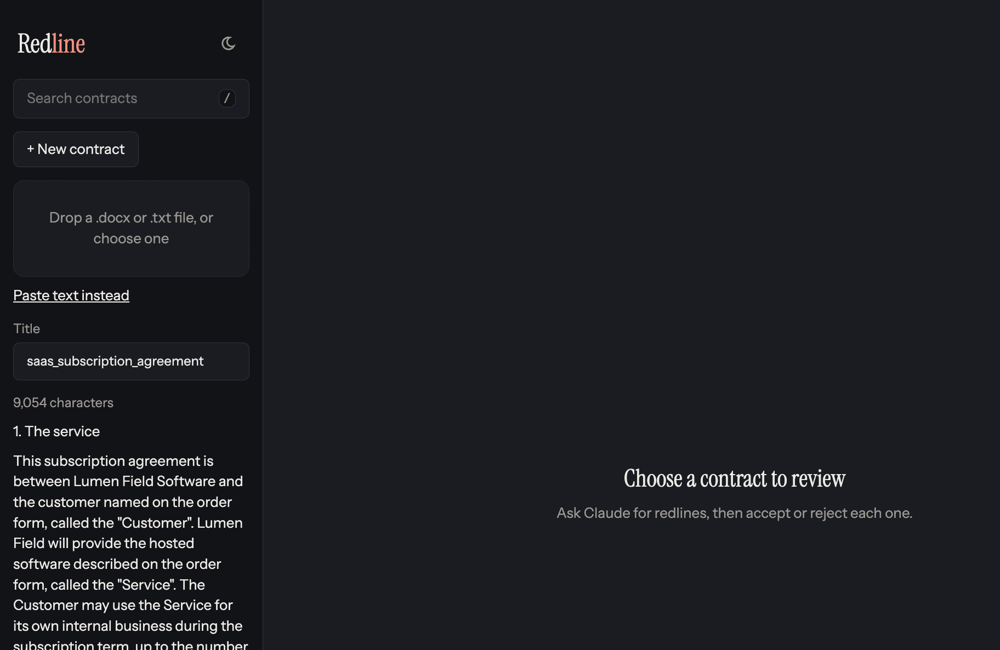
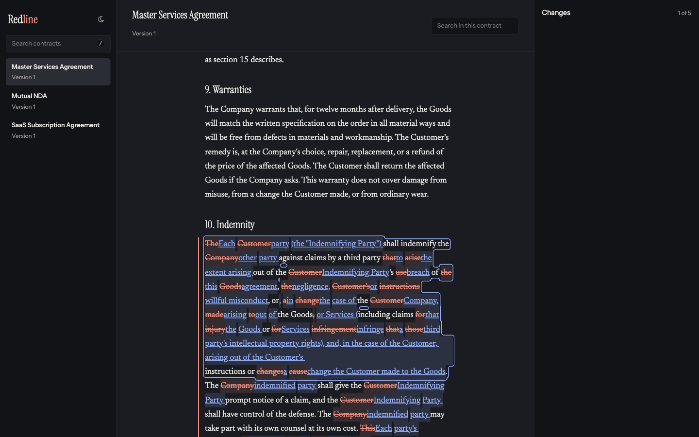
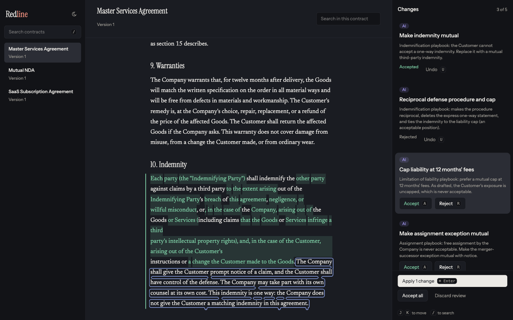
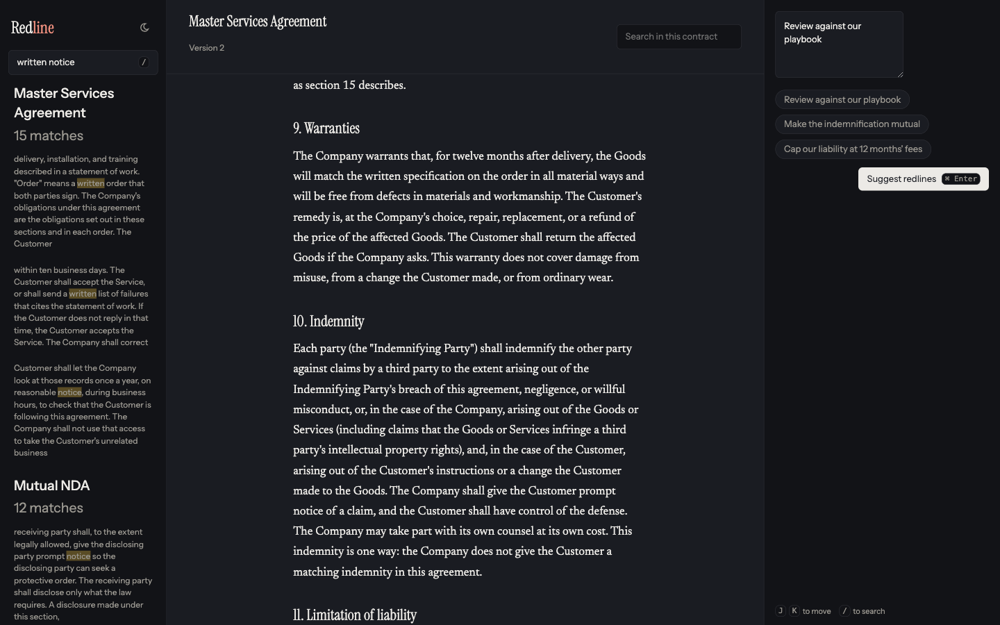

# Redline

## What it is

Redline stores plain-text contracts, suggests redlines with Claude, and applies the ones you accept as one new version. Each edit points at text by a character range, by the nth exact match, or by the words around a phrase, and a write succeeds only when the document is still the version the client read.

## How it fits a negotiation

One round of a contract negotiation is a cycle of drafts. Redline keeps each draft as a version of the same contract.

1. The other side's draft comes in as a new contract (version 1), from a Word file, a text file, or pasted text.
2. You review it with Claude, accepting and rejecting suggestions.
3. You apply your decisions as the next version and download it to send back.
4. When their reply comes back, Upload next draft saves it as the next version of the same contract, and the cycle repeats.


## Setup

Tested with Docker 29.9.2, uv 0.13.7, Node 26.13.0, and npm 11.20.0. uv installs Python 3.14 itself (3.14.10 here).

1. Install Docker Desktop, [uv](https://docs.astral.sh/uv/), and Node 22 or newer with npm.
2. Copy the environment file. Add `ANTHROPIC_API_KEY` if you want AI suggestions. Everything else works without it.

   ```bash
   cp .env.example .env
   ```

3. Start Postgres:

   ```bash
   make db-up
   ```

4. Install the backend and the frontend:

   ```bash
   make install
   make ui-install
   ```

5. Load the three sample contracts:

   ```bash
   make seed
   ```

6. Start the API and the review UI, in two terminals:

   ```bash
   make dev
   make ui
   ```

   The API is at http://localhost:8000 and its interactive docs are at http://localhost:8000/docs. The review UI is at http://localhost:5173.

7. To reset the sample contracts later, run `make reseed`, then restart `make dev`. The search index is built when the server starts, so a seed that runs while the server is already up does not appear in search until that restart.

`make db-up` creates two databases, `redline` and `redline_test`. To use your own Postgres, create a role and both databases, then point `DATABASE_URL` and `TEST_DATABASE_URL` in `.env` at them. The app creates the tables on startup. Tests create them too, and they roll their writes back.

### Ports

The API listens on 8000, the review UI on 5173, and Postgres on 5433, so it does not collide with a Postgres already on 5432.

When 8000 is taken, start both processes on the same other port and point the curl walkthrough at it:

```bash
make dev PORT=8002
make ui PORT=8002
BASE_URL=http://localhost:8002 ./samples/curl_requests.sh
```

When 5433 is taken, set `POSTGRES_PORT` and use that same port in `DATABASE_URL` and `TEST_DATABASE_URL`. The three have to agree. Then run `make db-up` again.

## Usage

The examples use `BASE_URL`. It defaults to `http://localhost:8000`.

Create a document:

```bash
BASE_URL="${BASE_URL:-http://localhost:8000}"
curl -sS -D - -o /tmp/document.json \
  -X POST "$BASE_URL/documents" \
  -H "Content-Type: application/json" \
  --data '{"title":"Demo","text":"Alpha. The Customer shall pay. Beta. The Customer shall wait.","author":"Ada"}'
```

The response headers include `ETag` and `Location`. Read it back:

```bash
BASE_URL="${BASE_URL:-http://localhost:8000}"
curl -sS -D - "$BASE_URL/documents/DOCUMENT_ID"
```

Send edits with `PATCH` and the `ETag` you just received in `If-Match`. A range replaces those characters (an empty replacement deletes; the same start and end inserts):

```bash
BASE_URL="${BASE_URL:-http://localhost:8000}"
curl -sS -X PATCH "$BASE_URL/documents/DOCUMENT_ID" \
  -H "Content-Type: application/json" \
  -H "If-Match: \"DOCUMENT_ID-1\"" \
  --data '{"author":"Ada","changes":[{"target":{"type":"range","start":0,"end":5},"replacement":"First"}]}'
```

An occurrence replaces one exact match. This changes the second "The Customer shall":

```bash
BASE_URL="${BASE_URL:-http://localhost:8000}"
curl -sS -X PATCH "$BASE_URL/documents/DOCUMENT_ID" \
  -H "Content-Type: application/json" \
  -H "If-Match: \"DOCUMENT_ID-1\"" \
  --data '{"author":"Ada","changes":[{"target":{"type":"occurrence","text":"The Customer shall","occurrence":2},"replacement":"The Customer must"}]}'
```

Context replaces the match that sits between a prefix and a suffix, so a repeated phrase still names one clause:

```bash
BASE_URL="${BASE_URL:-http://localhost:8000}"
curl -sS -X PATCH "$BASE_URL/documents/DOCUMENT_ID" \
  -H "Content-Type: application/json" \
  -H "If-Match: \"DOCUMENT_ID-1\"" \
  --data '{"author":"Ada","changes":[{"target":{"type":"context","text":"The Customer shall","prefix":"Alpha. ","suffix":" pay."},"replacement":"The Customer will"}]}'
```

Search does not change a document, so it is a GET. A word, two words that must both appear, and a quoted phrase:

```bash
BASE_URL="${BASE_URL:-http://localhost:8000}"
curl -sS "$BASE_URL/search?q=Customer"
curl -sS --get "$BASE_URL/search" --data-urlencode "q=Customer invoice"
curl -sS --get "$BASE_URL/search" --data-urlencode 'q="written notice"'
```

Limit the search to documents you name, or to one document:

```bash
BASE_URL="${BASE_URL:-http://localhost:8000}"
curl -sS --get "$BASE_URL/search" \
  --data-urlencode "q=Customer" \
  --data-urlencode "document_ids=DOCUMENT_ID"
curl -sS "$BASE_URL/documents/DOCUMENT_ID/search?q=Customer"
```

Run the full walkthrough with:

```bash
./samples/curl_requests.sh
```

It prints status codes and short JSON. Contract text is reported by length, not printed. `BASE_URL` picks the server, and it defaults to `http://localhost:8000`. The script creates a document, tries all three target types, a mixed batch, a stale `If-Match` (412), a missing `If-Match` (428), an overlap (422), missing text (422), an unknown id (404), version history, and search. A query with no words, such as `q=""`, returns 422 `invalid_query`. The last step asks for redlines on the seeded Master Services Agreement and applies the ones that anchored. With no API key, that step prints `ai_not_configured` and skips the apply.

## Architecture



A request enters through `api`, which validates the payload, checks `If-Match`, and calls one service for a write. Reads that are a single query call the repository directly. On a write, the service loads the version named by `If-Match` and asks `editing` to resolve and apply the changes outside any transaction, so a large rebuild never holds a lock. It then commits in one transaction: bump the version with a compare-and-swap and insert the new version. Only after commit does it tell `search` which ranges changed. On startup the search index is rebuilt from the latest version of every document in Postgres. For AI redlines, a short document goes to the model whole. A longer one sends the paragraphs that best match the instruction. Each suggestion is anchored against the full document before it is returned.

## API design

Documents are plain text by design. Edit targets, versioned writes, search highlights, and AI suggestions all point at a character offset, so a position in the document is a character offset. Rich formatting needs a document model where a position is no longer a character offset.

Documents and versions are resources. Edits are a `PATCH` with our own change format, because JSON Patch addresses JSON fields, not spans of the document text. Search is a `GET` because it only reads, and the query, the document ids, and the page can be bookmarked. `POST /documents/{id}/ai-redlines` is an action: it runs an expensive model call from an instruction, returns a computed result, and is not repeatable. Applying the suggestions the reviewer accepts reuses `PATCH` instead of adding an accept endpoint.

A read that is a single query calls the repository directly. A write goes through the document service, which is the only place that applies edits.

A change has no `operation` field. Every change means "replace this span." An empty replacement deletes. A target whose start and end are the same inserts. The span can be named in three ways, because lawyers edit wording rather than offsets. A range is exact and breaks if anything earlier in the document changes. An occurrence number is easy to type and shifts when another match is added above it. Context, a prefix and a suffix in the style of the W3C TextQuoteSelector, survives most edits elsewhere and says which copy is meant.

A batch is atomic. Every target is resolved against the current text before any new text is built. If one target is missing, ambiguous, or overlapping, nothing is saved.

`q` is required and may be 1 to 500 characters. Repeat `document_ids` to search only those documents; leave it off to search everything. `/documents/{id}/search` is the same search limited to one document. A document that is not in the index is a 404, the same `document_not_found` as a missing document. `mode=prefix` is for search-as-you-type; the last unquoted word matches as a word prefix. Leave `mode` off, and every word has to match in full.

Reads return a strong ETag, `"<document id>-<version>"`. A write must send that value in `If-Match`. The service checks the version before it does the work, then claims the next version with `UPDATE ... WHERE current_version = <expected>` inside a short transaction. The first writer wins. A second writer, or a stale, weak, wildcard, or foreign ETag, gets 412. A missing `If-Match` gets 428.

Every error body is JSON:

```json
{"error": "A readable message", "code": 422, "error_type": "target_not_found"}
```

| Status | `error_type` | When |
| --- | --- | --- |
| 422 | `validation_error` | The JSON or query parameters do not match the request shape |
| 422 | `invalid_query` | The query has no words |
| 422 | `invalid_target` | A target is malformed, such as a start after its end |
| 422 | `range_out_of_bounds` | A range ends past the document |
| 422 | `target_not_found` | The text or occurrence is not there |
| 422 | `ambiguous_target` | A context matches more than once |
| 422 | `overlapping_changes` | Two changes cover the same character, or both insert at the same place |
| 404 | `document_not_found` | No document with that id |
| 404 | `version_not_found` | That document has no such version |
| 412 | `precondition_failed` | `If-Match` is stale or not one of our ETags |
| 428 | `precondition_required` | `If-Match` was omitted |
| 503 | `ai_not_configured` | No Anthropic API key is set |
| 502 | `model_unavailable` | The model call failed |
| 502 | `model_response_invalid` | The model response was truncated, refused, or not the expected JSON |
| 404, 405, others | `http_error` | The path or method does not exist |
| 500 | `internal_error` | Anything else. The message is always "Internal server error" |

## AI redline suggestions

`POST /documents/{id}/ai-redlines` takes an instruction and returns suggestions for the current version, plus an ETag for that version. The model is Claude Sonnet. Its reply is constrained to a JSON schema: a list of quotes, each with a short title, the surrounding words, a replacement, and a rationale. The contract is sent as data. Instructions inside the contract are not followed.

A document of 100,000 characters or less is sent whole. A longer one sends the paragraphs that best match the instruction. Either way, each quote is checked against the full document. A quote with the right surrounding words is pinned to that span. If those words miss but the quote appears once, it is pinned anyway. A quote that is empty, unchanged, missing, ambiguous, or overlapping an earlier suggestion is returned in `dropped` with a reason, and it is not applied.

Accepting the suggestions is the same `PATCH` as any other edit: one range target per anchored suggestion, and `If-Match` set to the ETag from the suggestion response. If the document changed in between, the patch returns 412.

Set `ANTHROPIC_API_KEY` in `.env`. Without it the route returns 503 `ai_not_configured`. A failed call returns 502 `model_unavailable`. A truncated, refused, or unusable reply returns 502 `model_response_invalid`.

One live review of the seeded Master Services Agreement, with the instruction "Review against our playbook", returned five anchored suggestions. One of them:

**Cap liability at 12 months' fees.** Limitation of liability playbook: prefer a mutual cap at 12 months' fees. The draft leaves the Company uncapped as drafted with no cap protecting the Customer; a mutual cap ensures the Customer is never uncapped.

Original: "For every other claim arising out of this agreement, the Company's total liability is not capped by the fees paid and is not limited to a multiple of those fees."

Replacement: "For every other claim arising out of this agreement, each party's total liability is limited to the fees paid and payable under this agreement in the twelve months before the claim arose."



## Search design

There are two searches, and each one fits its job.

Across contracts, the server index answers. Exact whole words are the default, for precise clause hunting. `mode=prefix` is for search-as-you-type: the last word being typed matches as a word prefix, and the earlier words stay exact. The left-hand search also filters contract names in the browser as soon as the first character is typed, from the list already on screen.

Within an open contract, find runs in the browser, because the text is already there. It is literal and instant, highlights every match, and steps through all of them. The per-document search endpoint remains for API clients; the header field does not call it.

The index is hand-built. The usual BM25 libraries do not store word positions, and they do not update one paragraph of a document after an edit.

Words are folded to one case. A hyphenated word stays one token, so `non-disclosure` does not become two words. One trailing possessive is dropped, so `Company's` and `Company` match, and the highlight still covers `Company's`. There is no stemming: legal wording is matched as written.

Every word has to appear. A quoted phrase has to appear as consecutive words inside one paragraph. A phrase does not match across a blank line. BM25 scores the whole document (k1 = 1.2, b = 0.75), using Lucene's always-positive inverse document frequency. A phrase counts through its words. It does not get an extra boost.

The text is split into paragraphs, and each paragraph keeps the blank lines after it, so the chunks tile the document with no gaps. Token positions are stored relative to the paragraph. An edit can move every later paragraph by changing one start offset, instead of rewriting every posting after the edit.

The database is the source of truth. After a create or edit commits, the service updates the index. When the indexed version is the version the edit was based on, only the touched paragraphs (and one neighbor on each side) are rebuilt. When the version does not match, or that rebuild fails, the document is indexed from scratch. If that also fails, the request still succeeds: the write is already saved, and the next full load will repair the index. One lock guards the index. The process holds the corpus text in memory, and the index is not shared with another server.

## Performance

Applying changes one at a time would copy the whole document for each change. The engine resolves every target first, sorts the spans, and joins slices once. That rebuild is linear in the document length plus the number of changes. Each text target is a scan of the document, so resolution grows with the document length times the number of text targets. Range targets are constant time. `AppliedEdit` offsets refer to the text from before the batch, so a later step can move other spans without replaying the edits.

The edit is computed with no transaction open. The compare-and-swap is one update that both checks and claims the next version, so a 10MB rebuild does not hold a row lock. Versions store the full text, which is simple and exact. At 10MB times many versions that cost is real; storing deltas is a later step.

On this machine, a pytest run measured two 10MB cases. Applying 1,000 range changes and checking them against a one-change-at-a-time rebuild took 0.42 seconds (`test_thousand_range_changes_match_one_at_a_time_reference`). Creating a 10MB document, applying 200 occurrence changes through the API, and reading version 2 back took 0.38 seconds (`test_large_document_round_trip_through_api`).

`make bench` times the index against a case-insensitive regex scan. Each number is the median of 5 runs. The contract is the same 10MB delivery text the large tests use. The cross-document case is 20 copies of a 500KB contract, with one sentence about an escrow agent added to document 7 only.

| Case | Indexed ms | Naive ms | Speedup |
| --- | ---: | ---: | ---: |
| Build 10MB index | 2949 | - | - |
| Rare phrase "Schedule 44204 to the Customer" | 44.7 | 58.7 | 1.3x |
| Common word customer | 0.009 | 52.3 | 6068.6x |
| Common phrase "written notice" | 47.4 | 32.7 | 0.7x |
| Two words supplier reject | 0.008 | 121 | 14858.2x |
| Update after 1 edit | 93.4 | 2574 | 27.6x |
| Update after 100 spread edits | 300 | 2927 | 9.8x |
| Apply 1,000 range changes | 1.5 | - | - |
| Cross-document escrow phrase | 0.692 | 92.9 | 134.4x |

An incremental update beats re-indexing the whole 10MB text, about 28 times for one edit and about 10 times for 100 edits spread through the document. The cross-document query is about 134 times faster than scanning all 20 texts, because the other 19 documents do not contain the words and are never opened.

A common word, or two common words, returns in well under a millisecond. The occurrence count is already stored on the document, and the snippet stops after the first three matching paragraphs. The regex scan still reads the whole file.

A rare phrase beats the scan. The section number is missing from almost every paragraph, so those paragraphs are rejected with a dictionary check and no position map is built. "written notice" does not. Both words are in every paragraph of this contract, so no index can skip a paragraph, and counting every match is a Python loop per paragraph against one regex pass in C (0.7x).

Routes are synchronous. psycopg is synchronous, and FastAPI runs sync routes in a thread pool, so the server does not mix async and blocking database calls.

## Testing

`make test` runs the backend suite, including the 10MB document tests. Tests that write to Postgres use `TEST_DATABASE_URL` and roll the transaction back, so they leave the test database empty. `make ui-test` runs the frontend tests. `make bench` prints the search timings in the table above. `make lint` runs Ruff on the backend. `make ui-lint` runs ESLint, the TypeScript check, and Prettier on the frontend.

`npm audit --omit=dev` reports no advisories. `npm audit` reports 10 moderate advisories, all in development tools (`minimatch`, through ESLint and typescript-eslint). The only offered fix is a breaking downgrade, so it was left as is.

## Review UI

The review screen is a separate frontend. `make ui` proxies `/api` to the API, so the page and the API share an origin and the browser can read the `ETag`. `make ui-types` regenerates `frontend/src/api/schema.ts` from the running API.

Open http://localhost:5173. Add a contract from a `.docx`, a `.txt`, or pasted text, or choose one that is already there, then ask for redlines. Download the saved version as a Word file or as plain text. Upload next draft saves the other side's reply as the next version of that same contract.



Open a contract, then ask for redlines. Three presets fill the instruction and send it: review against the playbook, make the indemnification mutual, or cap liability at 12 months' fees. Each suggestion appears in the contract as a word-level deletion and insertion, with a title and the reason in the changes column. Accept or reject each one, then apply the accepted ones. That writes one new version, and only if the contract is still the version the review was read from. If it is not, the screen says the contract changed and offers to run the review again.







| Key | Action |
| --- | --- |
| J, K | Next or previous suggestion |
| A | Accept the active suggestion |
| R | Reject the active suggestion |
| U | Undo the active decision |
| / | Focus find in the open contract, or the contract list when none is open |
| ⌘ Enter or Ctrl Enter | Send the instruction, or apply once a review is open |
| Esc | Clear search, or clear the instruction |
| Enter, Shift Enter | Next or previous match in the open contract |

The theme control switches between light and dark, and remembers the choice in this browser. Search covers every contract from the left: matching names appear immediately, and text matches follow, with the last word treated as a prefix. Inside an open contract, find steps through every literal match. A match from the left-hand results scrolls into view and stays marked until the search is cleared, another contract is opened, or a review starts.

The document is the page: a serif body at a comfortable measure, and quiet chrome. Color is reserved for a deletion, an insertion, an acceptance, and the AI tag. Deletions are struck through and insertions are underlined, so a change still reads without color. Decisions stay on the review until Apply, which sends them as one versioned write with `If-Match`. The TypeScript types for responses are generated from the API schema.

## Built with

Built with AI coding assistance, as the brief allows. The core is the editing engine, the versioned API, search, and the tests. AI suggestions and the review UI were added on top. TODO(Melanie): time

## Next steps

**Meet lawyers in Word.** Lawyers live in Microsoft Word, so the production client is a Word add-in (Office.js) calling this same API. Claude's suggestions appear as native Word tracked changes, with the rationale as comments. Search and the review panel live in Word's task pane. Formatting stays untouched, because the add-in maps character ranges onto Word's own ranges. The engine, versioning, search, and AI anchoring carry over unchanged.

- Your own edits as tracked changes in the web UI, staged next to Claude's and applied as one version.
- Keeping Word formatting on import and export. Import and download today keep the words, not the formatting.
- PDF import.
- A blackline compare between versions, showing what the other side changed in their draft.
- Auth, users, and per-document permissions. The author is a plain name field.
- Comment threads separate from proposal rationales.
- A phrase-match boost on top of BM25.
- A map from a term to the paragraphs that contain it, so a phrase search does not walk every paragraph.
- A persistent or external index, such as Postgres full-text search or OpenSearch, so more than one server can search.
- A search mode that can loosen AND semantics. The current search requires every word.
- Embedding-based semantic search with hybrid re-ranking.
- Stored proposals with rebasing. The algorithm is in `editing/rebase.py`, with tests. Moving a proposal forward when an edit lands, and accept and reject, are not stored yet.
- Multi-pattern target resolution (Aho–Corasick) for very large batches of text-targeted changes.
- Multi-process deployment. The in-process search index assumes a single server.
- Storing versions as deltas instead of full copies.
