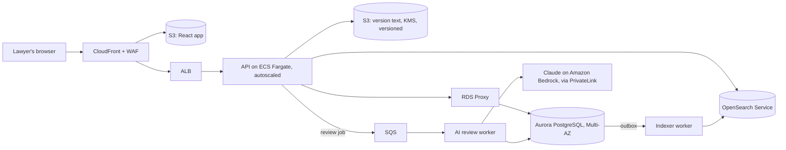

# Redline in production

How the prototype becomes a service that law firms trust with live contracts. It's written for AWS. The guiding constraint: **contract text is the most sensitive data a firm holds**, so every choice below favors isolation, auditability, and correctness over raw speed.

## What has to change from the prototype

| Prototype | Why it breaks in production | Production |
|---|---|---|
| In-memory search index in the API process | Ties the API to one server; lost on restart; memory grows with the corpus | Amazon OpenSearch Service, fed by a transactional outbox (below) |
| Full text of every version in Postgres | A 10MB contract with 50 turns is 500MB of rows | Version text in S3, content-addressed (SHA-256), with metadata in Postgres |
| The model call holds the HTTP request open for 10–20 seconds | Ties up workers, and a deploy or dropped connection loses the review | Review jobs on SQS, run by a worker; the UI follows progress over server-sent events |
| `schema.sql` applied on startup | No safe way to change the schema | Versioned migrations (Alembic), with expand-then-contract changes |
| Author is a free-text name | No identity, no permissions | SSO, with per-matter access (below) |

## Architecture

- **The API stays stateless.** Every write still uses the prototype's compare-and-swap on `current_version`, and an outbox row is written in the **same transaction**. The indexer applies outbox rows to OpenSearch by `(document_id, version)`, so retries are safe and the index can never go backwards. Index lag is a first-class metric.
- **Claude runs on Bedrock in our own AWS account,** reached over PrivateLink. Contract text never crosses the public internet, and data stays under AWS terms: no training on our data. Firms ask about this first.
- **RDS Proxy** stops a burst of slow requests from exhausting database connections. The prototype already returns its connection before the model call; Proxy enforces that at the infrastructure level.

## Meet lawyers in Word

Lawyers draft and negotiate in Microsoft Word, and they won't switch editors. The production client is a **Word add-in** (Office.js) calling the same API. Claude's suggestions arrive as native tracked changes, with the rationale as comments. Search and review live in Word's task pane, and the document keeps its formatting. The add-in maps Redline's character ranges onto Word's own ranges, so the engine, versioning, search, and AI anchoring carry over unchanged. The web app stays for portfolio-wide search and admin. The add-in ships through Microsoft 365 centralized deployment, so a firm's IT team can roll it out without anyone installing anything.

## CI/CD and deployment

- GitHub Actions on every PR runs Ruff, pytest (with a Postgres service container, including the 10MB tests), Vitest, type checks, a dependency scan, and a container image scan.
- On merge: build the image once, push it to ECR, migrate staging, deploy staging, run smoke tests (the curl walkthrough), then **blue/green to production** with CodeDeploy, rolling back automatically on alarm.
- Migrations follow expand then contract: add a column and backfill it, deploy code that uses it, then drop the old column in a later release. Old and new code can both run during a deploy.
- AI changes (prompt, model, effort) are behind feature flags, and each new prompt is evaluated against a fixed set of contracts before rollout. **The anchored-to-dropped ratio is the regression test.**

## Security and compliance

- **Identity:** SAML/OIDC SSO through the firm's identity provider (Okta, Entra ID), with SCIM provisioning. No local passwords.
- **Access:** documents belong to matters, and permissions are per matter. Ethical walls, which keep a team that's conflicted out from seeing a matter, are enforced in the database with Postgres row-level security keyed on tenant and matter, not just in application code.
- **Encryption:** TLS 1.2+ everywhere, and KMS at rest for Aurora, S3, OpenSearch, and SQS. Enterprise tenants can bring their own key, and revoking it makes their data unreadable.
- **Audit log:** every read, edit, search, and AI review is recorded with user, document, version, and request id. It's append-only and exported to S3 with Object Lock (write once). This is also the "who changed what" answer lawyers need.
- **Logs never contain contract text,** which the prototype already enforces. Secrets live in Secrets Manager.
- **GDPR and SOC 2:** EU tenants are served from an EU region, with retention policies, per-tenant deletion, and legal hold, and a DPA listing Bedrock as a subprocessor. SOC 2 Type II evidence comes from the pipeline itself: required reviews, no direct production access (break-glass is logged), quarterly access reviews, and continuous control monitoring.

## Scalability and resilience

- **Autoscaling:** the API scales on request count, the AI workers on queue depth, and the indexer on outbox age.
- **Large and bulk work goes async:** big uploads go straight to S3 through presigned URLs, and bulk imports and portfolio reviews ("which of our 400 vendor contracts have a change-of-control clause?") run as batched jobs.
- **Failure handling:** Multi-AZ everything. Aurora point-in-time recovery, and an OpenSearch index that can always be rebuilt from Postgres and S3. Targets: **RPO 5 minutes, RTO 1 hour.**
- **When the model is unavailable,** reviews queue and retry with backoff. Editing and search keep working, because AI is never on the critical path for an edit.

## Monitoring and observability

- OpenTelemetry traces carry the request id the prototype already logs, from the browser through the API, queue, worker, and Bedrock. Logs are structured JSON.
- **Service metrics:** p95 latency per endpoint, error rate, and the 412 rate (how often reviewers collide). **Search metrics:** query latency and index lag. **AI metrics:** latency, tokens and cost per tenant, the anchored and dropped ratio, and drop reasons.
- **Alerts** on SLO burn rate (99.9% for edit and search), index lag over 60 seconds, AI error rate, and database connection saturation.

## Operations and cost

- **The biggest cost is model tokens,** then storage. To control tokens:
  - prompt caching for the playbook and system prompt;
  - a per-tenant monthly budget with alerts;
  - retrieval instead of the whole document for long contracts;
  - routing simple instructions to a smaller model.
- **Storage:** S3 lifecycle rules move old versions to Infrequent Access, then Glacier, which lawyers rarely need in under a minute. Versions are content-addressed, so identical text is stored once.
- **Compute:** right-size from metrics, and run the AI and indexer workers on Fargate Spot, since their jobs can retry. Dashboards show cost per tenant.
- **Regions:** one region per jurisdiction to start, with cross-region backups. Active-passive failover is for enterprise contracts that require it; active-active isn't worth the conflict handling for this workload.

## Priorities

1. **SSO, per-matter access, and the audit log.** No firm signs without them.
2. **Move search to OpenSearch with the outbox**, which unblocks running more than one API server.
3. **AI reviews as queued jobs on Bedrock**, which makes them resilient, private, and cost-tracked.
4. **The Word add-in**, which is how lawyers actually adopt the product.
5. **Version text in S3**, for storage cost and large documents.
6. **Observability and SLOs**, then multi-region.

**Trade-off I'd call out:** OpenSearch adds a second store to keep in sync. The alternative, Postgres full-text search, is one system and transactional, and it handles phrase queries. But its ranking isn't BM25, it stems words by default (lawyers need "shall" and "may" kept exact), and heavy search competes with writes for database capacity. The outbox keeps the two stores consistent without distributed transactions.
