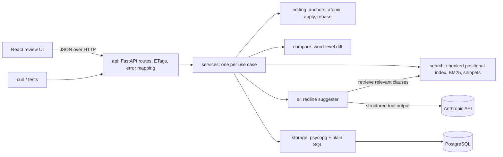

# Redline: Build Plan

## 1. Goal

Redline is a document redlining and search service for lawyers. Users edit contract text through a JSON API, either directly or as tracked proposals that a reviewer accepts or rejects. They can search clauses and phrases across documents, and ask an LLM to propose playbook-style redlines, each with a rationale. A React review UI ("Word's review pane, but better") sits on top.

Built for the Sandstone take-home (Part I). The infra write-up for Part II lives in `docs/infra.md`.

## 2. MVP

### Must have (the assessment baseline, built first)

- **Change requests:** `PATCH /documents/{id}` takes a list of changes and returns the updated text. A change targets text by character range, by text plus occurrence number, or by text plus surrounding context.
- **Atomic batch edits:** every target in a request is resolved first. Any overlap or unresolvable target rejects the whole request with a 4xx, and nothing is applied. The document is rebuilt in a single linear pass.
- **Search:** across all documents, a chosen set (`document_ids`), or one document, returning ranked snippets with highlight offsets. Supports multi-word queries and quoted exact phrases (rules in section 5).
- **Versioning and concurrency:** each write creates a new version. Reads return an `ETag`. Writes require `If-Match` and return `412` when stale.
- **Errors:** 4xx for client errors and 5xx for server errors, always as JSON `{ "error": string, "code": number, "error_type": string }` (section 4).
- **Tests:** unit tests for the editing engine and the search index, large-document (10MB) tests, and a benchmark script.
- **Docs:** README (setup, usage, performance, API design rationale) and a curl sample script.

### Should have (what makes it a redlining product)

- **Tracked proposals:** changes can be proposed instead of applied, with an author, a rationale, and a status (pending, accepted, rejected, stale). Accepting one applies it as a new version. When other edits shift the text, pending proposals are moved with it (rebased).
- **Version compare:** a word-level diff between any two versions (the "blackline").
- **AI redlines:** given an instruction and an optional playbook, the LLM returns structured proposals. They go through the same anchoring and validation pipeline as human edits, so the model never edits text directly.
- **Review UI:** three panes (document list, document with inline redlines, and a changes panel), search with jump-to-match, an AI redline panel, and keyboard review (next, previous, accept, reject).

### Deliberately left for later (documented as next steps in the README)

- Auth, users, and per-document permissions (the author is a plain name field).
- Rich text and .docx import/export. Documents are plain text.
- Comment threads separate from proposal rationales.
- Embedding-based semantic search and hybrid re-ranking.
- Multi-pattern target resolution (Aho–Corasick) for very large batches of text-targeted changes.
- Multi-process deployment. The search index is in-process memory, which assumes a single server (covered in Part II).
- Storing versions as deltas instead of full copies.

## 3. Architecture



A request enters through `api`, which validates the payload, checks `If-Match`, and calls one service for a write. Reads that are a single query call the repository directly, since a service that only forwards a call adds nothing. Services orchestrate and hold no business logic. `editing`, `search`, and `compare` are pure, with no I/O, so they are fast to unit test. On a write, the service loads the version named by `If-Match` and asks `editing` to resolve and apply the changes. This happens outside any transaction, so a large rebuild never holds a lock. It then commits in one transaction (rules in section 5): bump the version with a compare-and-swap, insert the new version, and rebase pending proposals through the same list of applied edits. Only after commit does it tell `search` which ranges changed, so it re-indexes just those chunks. On startup the search index is rebuilt from the latest version of every document in Postgres. For AI redlines, the service uses a separate retrieval function on the search index to pull the clauses relevant to the instruction, so 10MB documents never go to the model whole. It sends those clauses plus the playbook to the LLM and runs each suggestion through `editing`'s anchor resolution before saving it as a proposal.

## 4. Key decisions

| Decision | Choice | Main alternative | Why this one |
|---|---|---|---|
| Backend language | Python 3.14 | TypeScript | Your preference. 3.14 rather than 3.15 because 3.15 is only weeks old and library wheels can lag. |
| Web framework | FastAPI, served by Uvicorn | Flask, Litestar | Async, automatic OpenAPI docs (a free API explorer for reviewers), and it validates standard `@dataclass` request bodies, so the code can follow the dataclass rule. Uvicorn is the server process that listens on the port and hands requests to FastAPI. |
| Package and tool management | uv, Ruff, pytest | pip + venv, Black | Fast, one lockfile, one formatter and linter. |
| Storage | PostgreSQL through `psycopg` 3 (no ORM), schema in a `.sql` file, queries as plain SQL in the repositories | SQLite; an ORM such as SQLAlchemy | Handles many concurrent writers with row-level locks, where SQLite allows one writer at a time. It is the production database, so Part II describes the same system. Plain SQL keeps every query readable. Reviewers start it with `docker compose up`. |
| Version storage | Full text per version | Diffs per version | Simple and correct for a prototype. The cost at 10MB times many versions is called out in the README and Part II. |
| Change targeting | Three target types: range, text + occurrence, text + context (prefix/suffix, like the W3C TextQuoteSelector) | Range only | Lawyers' edits are about wording, not offsets. Context matching keeps an edit on the right clause when the same phrase appears many times. |
| Batch apply | Resolve all targets, sort, reject overlaps, rebuild once with string slices joined in one pass | Apply changes one at a time | O(n + k) instead of O(n x k), and atomic: either every change applies or none does. |
| Proposal anchoring | Store a range kept current by rebasing it through every applied edit, plus the original text as a check | Re-find the quoted text after every edit | Exact and linear. Every edit already goes through the engine, so the shifts are known. A proposal whose text was edited underneath it is marked stale instead of guessing. |
| Concurrency | Integer version; ETag `"{document_id}-{version}"`; `If-Match` required (428 if missing, 412 if stale). The first statement of the write transaction is a compare-and-swap: `UPDATE documents SET current_version = v + 1 WHERE id = ... AND current_version = v`, and zero rows updated means rollback and 412. | Last write wins; `SELECT ... FOR UPDATE` while computing the edit | The prompt asks for it, and it matches how lawyers lose work: two people editing the same draft. Doing the compare-and-swap first locks the row, so a racing writer fails before inserting anything, and the edit is computed before the transaction so no lock is held during it. |
| Error format | `{ "error": "<readable message>", "code": <HTTP status>, "error_type": "<stable code>" }` | `error` holding the stable code | Keeps the prompt's two fields, readable in curl output, while clients and tests branch on `error_type` (an enum). |
| Change JSON | Each change has a required `type`: `range`, `occurrence`, or `context`, mapping to three engine dataclasses | Infer the target type from which fields are present | Explicit, and validation errors name the problem. If FastAPI cannot validate the dataclass union, the route maps the JSON onto the dataclasses itself. |
| Search index | Custom in-memory positional inverted index, chunked by paragraph, with chunk-relative positions | Whoosh/Tantivy; `rank_bm25`; full rescan | Deliberate exception to "use a library": the prompt asks us to build and discuss one, and `rank_bm25` has no positions or incremental updates. Chunk-relative positions mean an edit re-indexes only the touched paragraphs and shifts the starts of later chunks. |
| Ranking | BM25 (k1 = 1.2, b = 0.75) | TF-IDF | The standard baseline. Easy to explain. |
| Tokenization | Lowercased word tokens with character offsets. Internal hyphens stay (`non-disclosure` is one token). A trailing possessive `'s` or `’s` is dropped from the indexed term, while the highlight covers the whole word. No stemming or stopword removal. | Stemming; keeping `company's` as its own term | Lawyers need exact words ("shall" vs "may"), but a search for the defined term "Company" must find "the Company's obligations". Offsets make highlighting exact. |
| Search semantics | Every unquoted term must appear somewhere in the document; quoted phrases must appear as consecutive tokens within one paragraph. BM25 scores the whole document from term counts summed across its chunks. One hit per document, with snippets. | Any term matches (OR); scoring each paragraph separately | Matches how lawyers search: precise, not fuzzy. One hit per document keeps cross-document results readable. |
| AI retrieval | A separate function that ranks paragraph chunks by BM25 over the instruction's content words, with any term matching, and returns the top chunks | Reusing user search | "Make indemnification mutual" would find nothing if every word had to match. User search stays exact. |
| Phrase queries | Quoted phrases match consecutive positions within a chunk | No phrases | Exact clause wording is how lawyers search. Phrases do not cross paragraph boundaries, which matches how clauses are written. |
| Version compare | `difflib.SequenceMatcher` on word tokens | `diff-match-patch` | Standard library, word-level output. The quadratic worst case is acceptable for comparing contract versions; noted as a risk for 10MB. |
| LLM | Anthropic Python SDK, Claude Sonnet 5.5, tool use with a strict JSON schema | Free-text output parsed with regex | Structured output can be validated. Every suggestion becomes a proposal with a rationale, never a direct edit. |
| LLM in tests | A `RedlineModelClient` protocol with a fake for tests | Mocking the SDK | Tests are deterministic and offline. The real client is used only at runtime. |
| API shape | Resources for reads and writes; POST actions for accept and reject | PATCH on proposal status | Accepting changes the document (a new version, an ETag check), so it is a command, not a field update. Rationale goes in the README. |
| Frontend | React 19 + Vite + TypeScript, TanStack Query, CSS Modules | Next.js; Tailwind | Single-page app with no server rendering needed. TanStack Query handles caching and refetching after writes. CSS Modules keep all styling in stylesheets. |
| UI build order | Functional UI first, design pass last | Design first | Your style: a solid foundation, then polish. |

## 5. Data model

Exact schemas belong in each phase plan.

**Storage (PostgreSQL)**

- `documents`: one row per document, with its title, current version number, and timestamps.
- `document_versions`: the full text of each version, with the author and a short summary of what changed (for example "Accepted 3 proposals"). The current text is the row whose version equals `documents.current_version`.
- `proposals`: a pending or resolved change, with its document, its current range, the original text it covers, the replacement, the prefix and suffix context, author, rationale, status (`ProposalStatus`: pending, accepted, rejected, stale), the version it was created on, and when it was resolved.

**Engine types (dataclasses, in `editing`)**

- `RangeTarget`, `OccurrenceTarget`, `ContextTarget`: the three ways to point at text. A change's target is a union of the three.
- `Change`: a target plus replacement text.
- `ResolvedChange`: a change pinned to an exact start and end.
- `AppliedEdit`: where an edit landed and how much the length changed. Used for rebasing proposals and for incremental re-indexing.

**Search types (in `search`)**

- `Chunk`: a paragraph-sized span of one document, with its start offset and its own postings (term to positions).
- `SearchQuery`: the parsed query, its terms and its quoted phrases.
- `SearchHit`: document, score, and snippets. `Snippet`: text with highlight ranges in absolute document offsets.

**AI types (in `ai`)**

- `PlaybookPosition`: a clause topic, preferred position, acceptable fallbacks, and positions never accepted.
- `RedlineSuggestion`: the model's structured output (quoted target with context, replacement, rationale), before it is validated.

### Behavior rules

These are settled. Phase plans implement them as written.

**Editing**

- Ranges are half-open `[start, end)` character offsets. Occurrence numbers start at 1. Text matching for anchors is case-sensitive.
- An empty replacement deletes. A zero-width range inserts.
- Changes in a batch are sorted by `(start, end)`. Changes that only touch at an edge both apply, so an insert at the start of a replaced range goes before it. Two zero-width inserts at the same position are rejected as overlapping, because their order would be arbitrary.
- `AppliedEdit` offsets refer to the text before the batch.

**Writes and proposals**

- Apply, propose, and accept all require `If-Match`. Anchors resolve against that version. Author is required on apply and propose.
- Apply and accept: compute the edit outside the transaction, then in one transaction: (1) the compare-and-swap on `documents` (zero rows → rollback, 412), (2) insert the `document_versions` row (unique on `document_id, version`), (3) rebase pending proposals, and for accept, mark that proposal accepted.
- Propose: in one transaction, lock the document row with `SELECT ... FOR SHARE`, confirm the version still matches (else 412), and insert the proposals with their prefix and suffix (32 characters each) taken from the document.
- Rebase, for each pending proposal and each applied edit: an edit that ends at or before the proposal start shifts it by the edit's length change; an edit that starts at or after the proposal end leaves it; any shared character marks it stale. So an insert at the proposal start shifts it, and an insert at its end leaves it. After every write, prefix and suffix are re-copied from the new text for all pending proposals.
- Accept works only on a pending proposal; reject works on pending or stale. Anything else is 409.
- The search index updates only after commit. The index records which version it has indexed for each document, and applies a chunk update only when that matches the version the edit was computed from. Otherwise, or on any error, it logs and re-indexes the whole document from the committed text. Index updates are serialized with a lock.

**API**

- Document ids are UUIDs. ETags are quoted: `"<id>-<version>"`.
- Status codes: invalid payload 422, unresolvable or ambiguous target 422, overlapping changes 422, missing document or proposal 404, proposal in the wrong status 409, stale `If-Match` 412, missing `If-Match` 428, unexpected errors 500. All use the error format in section 4.
- `POST /documents/{id}/ai-redlines` returns 200 with the proposals that anchored and the suggestions that were dropped, each with a reason code.
- Request ids are set by middleware in a context variable and included in every log line.

## 6. Folder structure

The backend packages map one-to-one to the architecture components. Each pure package (`editing`, `search`, `compare`) has no imports from `storage`, `api`, or `services`.

```
redline/
├── README.md                          # setup, usage, performance numbers, API design rationale
├── Makefile                           # one-word commands: install, dev, test, bench, seed
├── .env.example                       # ANTHROPIC_API_KEY, DATABASE_URL, TEST_DATABASE_URL, LOG_LEVEL
├── .gitignore
├── docker-compose.yml                 # local Postgres for reviewers, on host port 5433
├── docker/postgres/init/              # creates the redline_test database on first start
├── docs/
│   ├── infra.md                       # Part II: production architecture and trade-offs
│   ├── assessment-prompt.md           # the Sandstone prompt, gitignored because it is confidential
│   └── plans/
│       └── build-plan.md              # this plan; phase plans sit beside it
├── sample_data/
│   ├── contracts/                     # realistic seed contracts (MSA, NDA, SaaS agreement)
│   └── playbook.json                  # sample legal playbook used by AI redlines
├── samples/
│   └── curl_requests.sh               # runnable curl walkthrough of every endpoint
├── backend/
│   ├── pyproject.toml                 # dependencies pinned with ~=, Ruff and pytest config
│   ├── src/redline/
│   │   ├── main.py                    # builds the FastAPI app, registers routes and error handlers, rebuilds the index on startup
│   │   ├── config.py                  # settings read from the environment
│   │   ├── logging_setup.py           # log format with request ids
│   │   ├── editing/                   # pure redline engine: no I/O
│   │   │   ├── models.py              # targets, Change, ResolvedChange, AppliedEdit
│   │   │   ├── errors.py              # InvalidTargetError, RangeOutOfBoundsError, TargetNotFoundError, AmbiguousTargetError, OverlappingChangesError
│   │   │   ├── anchors.py             # resolves each target type to an exact range
│   │   │   ├── apply.py               # validates a batch and rebuilds the text in one pass
│   │   │   └── rebase.py              # moves pending proposal ranges through applied edits, marks overlaps stale
│   │   ├── search/                    # pure search engine: no I/O
│   │   │   ├── models.py              # Token, IndexedChunk, SearchQuery, SearchScope, SearchHit, Snippet
│   │   │   ├── errors.py              # EmptyQueryError, DocumentNotIndexedError
│   │   │   ├── tokenizer.py           # word tokens with character offsets
│   │   │   ├── chunker.py             # splits text into paragraph chunks
│   │   │   ├── query_parser.py        # splits a query into terms and quoted phrases
│   │   │   ├── index.py               # positional inverted index with incremental chunk updates
│   │   │   ├── ranking.py             # BM25 scoring
│   │   │   ├── snippets.py            # context windows with highlight offsets
│   │   │   ├── query_runner.py        # candidates, phrase check, scoring, paging
│   │   │   └── retrieval.py           # ranks paragraph chunks for AI redlines (any term matches)
│   │   ├── compare/                   # pure version compare
│   │   │   ├── models.py              # DiffSegment and DiffSegmentType
│   │   │   └── word_diff.py           # word-level diff between two texts
│   │   ├── ai/
│   │   │   ├── models.py              # PlaybookPosition, RedlineSuggestion
│   │   │   ├── model_client.py        # RedlineModelClient protocol and the Anthropic implementation
│   │   │   ├── prompts.py             # system prompt and the suggestion tool schema
│   │   │   ├── playbook.py            # loads the playbook file
│   │   │   └── redline_suggester.py   # retrieves clauses, calls the model, returns suggestions
│   │   ├── storage/
│   │   │   ├── schema.sql             # tables and indexes
│   │   │   ├── models.py              # typed rows: StoredDocument, DocumentSummary, DocumentVersion, ...
│   │   │   ├── errors.py              # DocumentNotFoundError, DocumentVersionNotFoundError
│   │   │   ├── database.py            # connection pool and schema setup
│   │   │   ├── document_repository.py # documents and versions
│   │   │   └── proposal_repository.py # proposals
│   │   ├── services/                  # orchestrates writes across engines and storage, one file per use case
│   │   │   ├── errors.py              # StaleVersionError
│   │   │   ├── document_service.py    # create a document, apply changes
│   │   │   ├── proposal_service.py    # propose, accept, reject, rebase
│   │   │   ├── search_service.py      # owns the live index, keeps it in sync with writes
│   │   │   ├── compare_service.py     # diff between two stored versions
│   │   │   └── ai_redline_service.py  # turns suggestions into validated proposals
│   │   └── api/
│   │       ├── schemas.py             # request and response dataclasses
│   │       ├── etags.py               # builds and checks ETag / If-Match
│   │       ├── error_handlers.py      # maps errors to { error, code, error_type } responses
│   │       ├── dependencies.py        # shared FastAPI dependencies (database connection)
│   │       └── routes/
│   │           ├── health.py          # /health
│   │           ├── documents.py       # /documents, /documents/{id}, versions, compare
│   │           ├── proposals.py       # /documents/{id}/proposals and accept/reject
│   │           ├── search.py          # /search and /documents/{id}/search
│   │           └── ai_redlines.py     # /documents/{id}/ai-redlines
│   ├── tests/
│   │   ├── conftest.py                # shared fixtures: test database rolled back per test, test client, fake model client
│   │   ├── fixtures/                  # small contract texts used across tests
│   │   ├── editing/                   # anchors, apply, rebase
│   │   ├── storage/                   # repositories against the test database
│   │   ├── services/                  # write paths, including the lost-race case
│   │   ├── search/                    # tokenizer, chunker, query parser, index, ranking, snippets
│   │   ├── compare/                   # word diff
│   │   ├── ai/                        # suggester with the fake client
│   │   ├── api/                       # endpoint tests through the FastAPI test client
│   │   └── large_documents/           # 10MB edit and search correctness
│   └── scripts/
│       ├── seed.py                    # loads sample_data/contracts into the database
│       └── benchmark.py               # engine and index vs naive scan, using tests/fixtures/large_contract.py; prints a table for the README
└── frontend/
    ├── package.json
    ├── vite.config.ts                 # dev proxy to the backend
    ├── tsconfig.json
    ├── index.html
    └── src/
        ├── main.tsx                   # mounts the app with the query client
        ├── app.tsx                    # three-pane layout
        ├── api/
        │   ├── client.ts              # fetch wrapper: ETag handling, error parsing
        │   └── types.ts               # TypeScript types matching the API schemas
        ├── features/
        │   ├── documents/             # document list and document loading
        │   ├── redline/               # document view with inline redlines, changes panel, accept/reject
        │   ├── search/                # search bar, results, jump to match
        │   ├── compare/               # version picker and blackline view
        │   └── ai_redlines/           # instruction box, playbook toggle, suggestion review
        ├── components/                # shared UI pieces (buttons, panels, badges)
        ├── hooks/
        │   └── use_keyboard_shortcuts.ts  # review shortcuts
        └── styles/
            ├── tokens.css             # colors, type, spacing, redline colors
            └── global.css
```

## 7. Phases

Phases 1 to 3 plus the README are a complete baseline submission. Everything after that is a layer on top. If time runs out, stop at a phase boundary and list the rest as next steps.

| # | Phase | Delivers | Depends on | Done when |
|---|---|---|---|---|
| 1 | Editing engine | `editing` package: all three target types, atomic batch apply, overlap rejection, `AppliedEdit` output, rebase. Project tooling (`pyproject.toml`, Ruff, pytest, Makefile). | Nothing | `make test` passes, including a 10MB document with 1,000 changes applied correctly. |
| 2 | Storage and document API | Postgres schema, `docker-compose.yml`, repositories, document service. Endpoints: create, list, get (with ETag), `PATCH` apply (with `If-Match`), list and get versions. Error handlers, request ids, seed script, curl samples. README: setup, usage, and API design rationale. | 1 | `make dev` runs against Postgres; `samples/curl_requests.sh` creates, edits, and reads a document; a stale `If-Match` returns 412, including when two writes race; API tests pass. |
| 3 | Search | `search` package and search service. Index rebuilt on startup; the write path now re-indexes changed chunks after commit. `GET /search` (with optional `document_ids`) and `GET /documents/{id}/search`, with paging. Benchmark script, with its numbers added to the README. | 2 | Phrase and multi-word queries return ranked snippets; editing a document updates results immediately; the benchmark prints indexed vs naive timings on 10MB. |
| 4 | Proposals and compare | Proposal endpoints (create, list, accept, reject, accept all); the write path now rebases pending proposals inside its transaction; stale detection, version compare endpoint. | 2 | Two overlapping proposals: accepting one marks the other stale. Proposals after an edit move with the text. Compare returns word-level insert and delete segments. |
| 5 | AI redlines | `ai` package, playbook, `POST /documents/{id}/ai-redlines`. Retrieval through `search/retrieval.py`. Invalid or ambiguous suggestions are dropped and reported. The tool-use settings (`tool_choice`, strict schemas) are checked against the current Anthropic docs for Sonnet 5.5 before they are written into the phase plan. | 3, 4 | With a real key, "make indemnification mutual" yields anchored proposals with rationales. Tests pass offline with the fake client. |
| 6 | UI foundation | React app: document list, document view with inline redlines, changes panel with accept and reject, search with jump to match, version compare, AI panel. Plain, functional styling. | 2 to 5 | Every API feature is usable from the browser end to end. |
| 7 | UI/UX polish | Design pass (type, color, layout, motion), keyboard review flow, change bars, empty and error states, loading states. Extra if time allows: a search mode toggle, "Exact" (every term must match, the default) vs "Natural language" (any term, ranked), like Westlaw's Terms & Connectors vs Natural Language. It reuses the ranking in `search/retrieval.py` through a `mode` query parameter. | 6 | It feels like a product a lawyer would want to use; a reviewer can step through a whole negotiation turn from the keyboard. |
| 8 | Docs and Part II | `docs/infra.md`; README refreshed with final benchmark numbers and the features from phases 4 to 7. | All | A fresh clone runs from the README alone. |

## 8. Risks and open questions

- **Time box.** The prompt says 3 to 4 hours, and this plan is larger. Phases 1 to 3 plus the README are the honest core; later phases are stretch work. Decide at each boundary whether to continue, and say in the README what was built after the time box, if anything. Find out: track time per phase.
- **FastAPI with dataclass unions.** The change target is a union of three dataclasses. FastAPI validates dataclasses through Pydantic, but a discriminated union of plain dataclasses needs checking. Find out: spike it at the start of phase 2. The fallback is to make only the three target request types Pydantic models, which support discriminated unions natively, as a stated exception to the dataclass rule.
- **Python speed on 10MB.** Tokenizing 10MB in pure Python may take around a second. The startup rebuild is fine; per-edit cost is avoided by chunked re-indexing. Find out: the phase 3 benchmark.
- **Word diff on large documents.** `SequenceMatcher` can go quadratic on long, repetitive texts. Find out: benchmark compare in phase 4. If slow, diff paragraph by paragraph first, then words within changed paragraphs.
- **LLM anchoring failures.** The model may quote text that is not exactly in the document. Find out: in phase 5, measure how many suggestions resolve; tighten the prompt to require exact quotes with context.
- **Reviewer setup.** Postgres adds a step that SQLite would not. Find out: run the README from a fresh clone with only Docker installed.
- **Full text per version.** Fine for the demo; it would grow fast in production. Covered in Part II.
- **Part III extension.** The live session may ask for a new redline rule or a search feature. The pure, typed engine packages are designed so either is a small, local change.

## 9. Engineering conventions

- All code follows the `code-guidelines` skill: dataclasses for structured data, enums instead of literals, docstrings on every function, absolute imports, no logic in `__init__.py`, logging with request ids at entry, exit, and error points, and no inline styles in the frontend.
- The process never crashes on a bad request: route handlers catch errors and return `{ error, code, error_type }`.
- Pure packages (`editing`, `search`, `compare`) do no I/O and do not import from `storage`, `services`, or `api`.
- Class docstrings keep the blank line Ruff's formatter adds (Ruff has no setting for it); no `# fmt: off` blocks.
- Tests follow set up, act, assert, and check error types and codes rather than message strings.
- Reviews use `code-guidelines-review`.
- Each phase gets its own plan in `docs/plans/` (for example `phase-1-editing-engine.md`). When a phase plan changes the architecture, structure, or phases, this file is updated in the same pass.
